<p align="center">
  
</p>

<h1 align="center">Qura'niyat Academy — Staff App</h1>

<p align="center">
  Subscription and payment tracking for a 1-on-1 online Qur'an academy.<br>
  Arabic-first, phone-first, in production since September 2026.
</p>

<p align="center">
  
  
  
  
  
  
</p>

---

## The problem

Qura'niyat Academy is a small, growing online academy where every student learns one-on-one
with their teacher over Zoom.
Families pay per block of classes with Vodafone Cash and talk to the academy on WhatsApp.

Everything about money was tracked by hand: who paid, who hasn't, and whose classes are about
to run out. That work fell on the owner every evening, and renewal reminders depended on
someone remembering to send them.

## What I built

A web app for the academy's staff that replaces that hand-run tracking, built around how the
academy already works instead of asking families to adopt something new.

- **Teachers** register their students, propose a tier and weekly time slots, and mark each
  class: *Delivered*, *Student absent*, *Cancelled*, or *Didn't happen*.
- **The supervisor** works queues: approves new students and confirms their tier and price,
  confirms the parent's WhatsApp number, and approves payment screenshots.
- **The owner** manages programs, tiers, prices and settings, and sees revenue without asking
  anyone.
- **Parents have no account.** They get a single-purpose link, upload a payment screenshot,
  and that's it. The amount owed is computed by the system (tier + sibling discount).
- **Renewal notices arrive in Telegram** as ready-to-send text with action buttons, so the
  supervisor can forward them to families on WhatsApp in seconds.

## How it works, step by step

Screenshots from the real app, running on an invented demo academy: every name, phone number and
payment is made up. Phone-sized, because that's how every role uses it.

**1. A teacher registers a student. The supervisor reviews the request.**
The teacher enters the child, the parent's WhatsApp number, a tier and weekly times. The
supervisor checks them, confirms the number and the price, and activates the subscription.

<p align="center">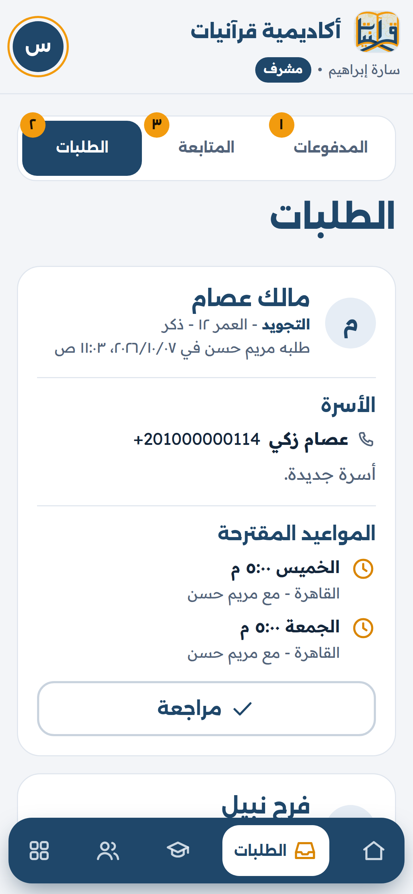</p>

**2. Teachers mark every class.**
Delivered, student absent, cancelled, or didn't happen (with a reason). Each mark updates the
family's period on the spot.

<p align="center">
  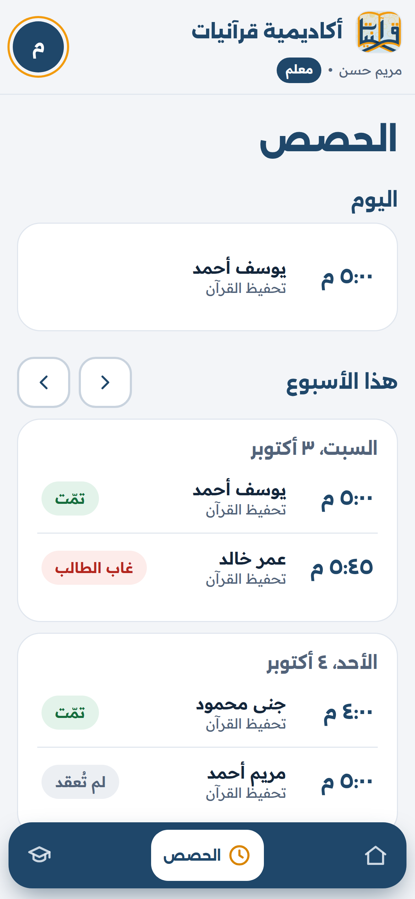
  &nbsp;
  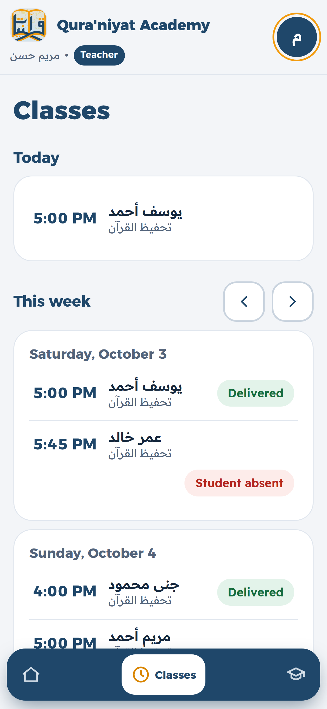
</p>

**3. Before a period runs out, a renewal notice is ready to send.**
A nightly job finds families whose classes are about to run out and sends the supervisor a
ready-to-copy WhatsApp message in Telegram, with the family's payment link. The same bot
reports new requests, uploaded payments, expired grace periods and classes nobody marked.
Each notice goes to one person, and tapping **Sent ✓** in Telegram marks the renewal as sent in the app.

<p>
  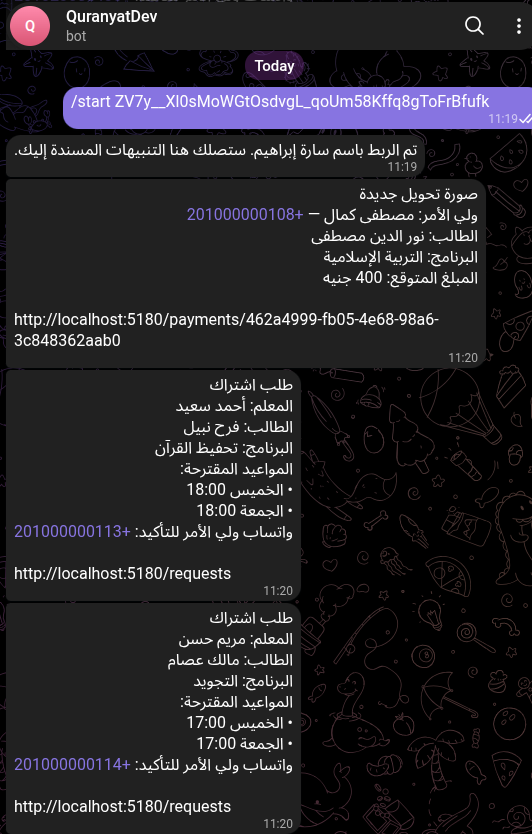
  &nbsp;
  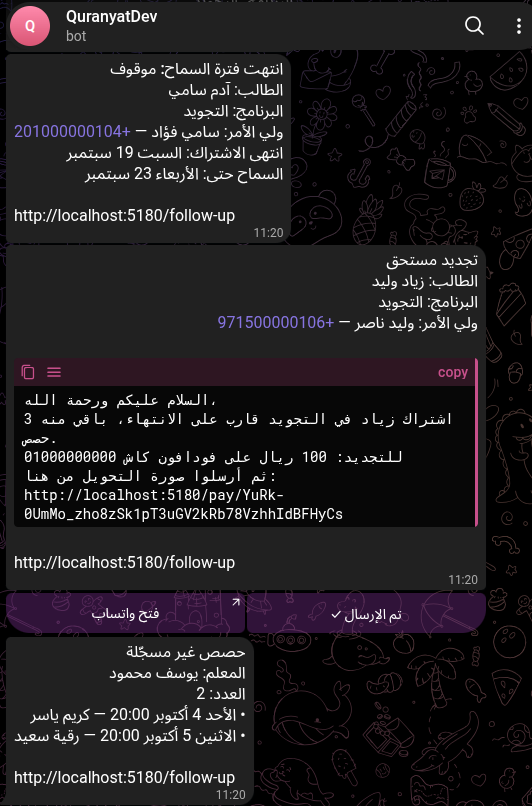
</p>

**4. The parent pays and uploads the screenshot.**
No account and no password: the link shows only the amount, the academy's Vodafone Cash number
and an upload button.

<p align="center">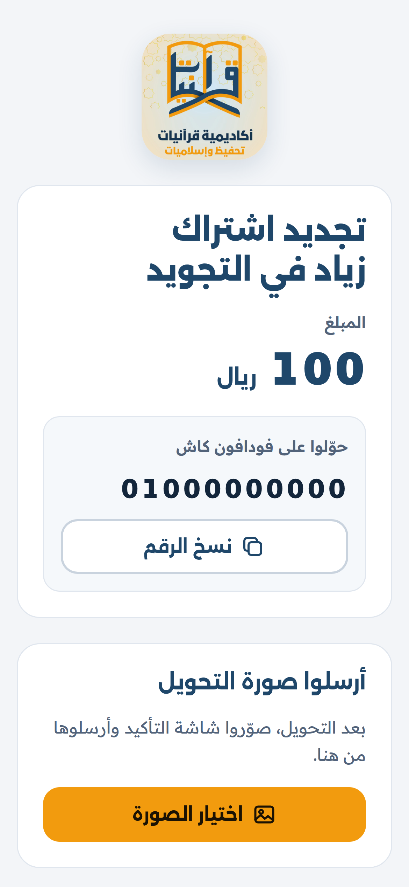</p>

**5. The supervisor checks the payment and approves it.**
The screenshot is compared against the wallet. Approving settles the period and closes its
notices.

<p align="center">
  
  &nbsp;
  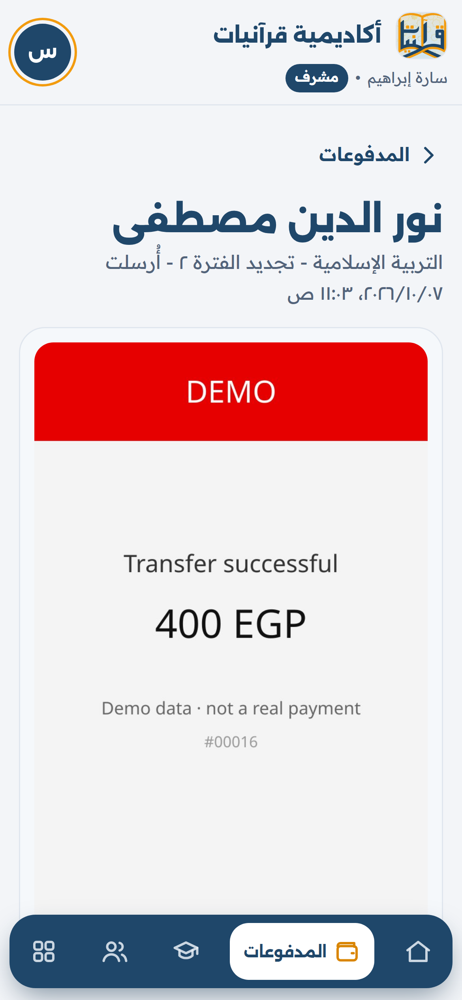
</p>

**6. Nothing slips through.**
The follow-up screen lists renewals still to send, families past their grace period (their
classes go on hold), and teachers who haven't marked their classes.

<p align="center">
  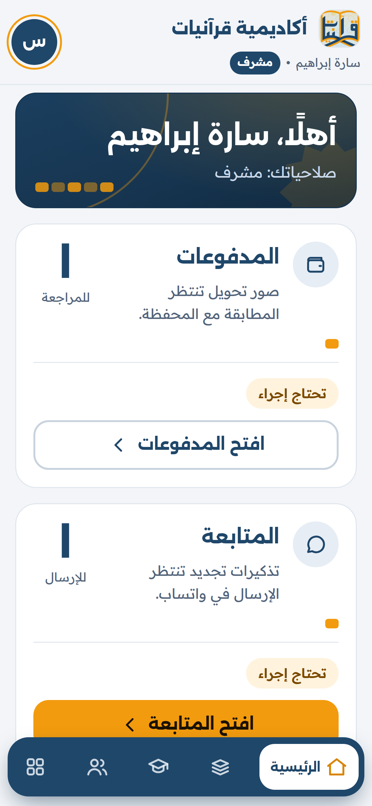
  &nbsp;
  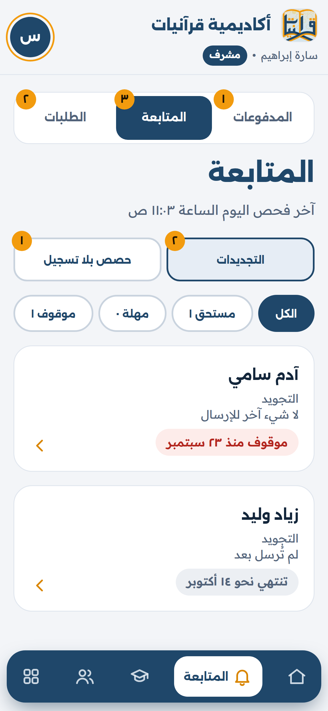
  &nbsp;
  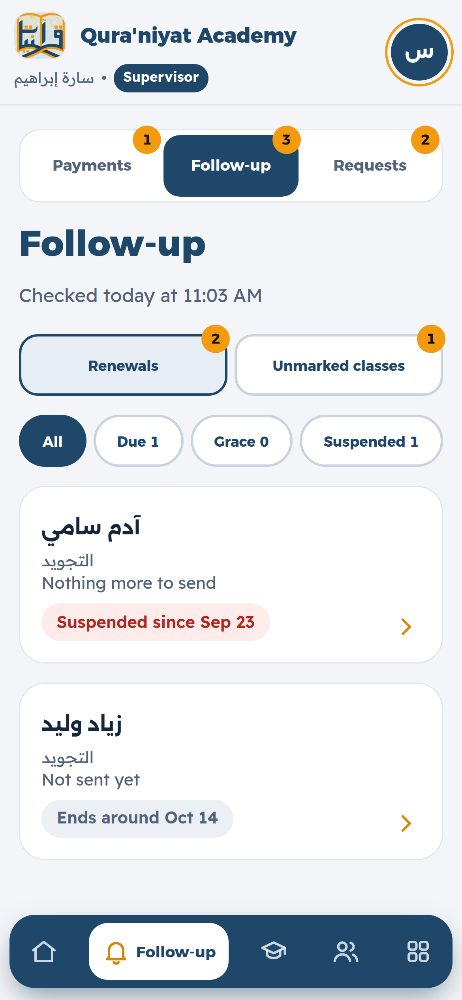
</p>

**7. The owner runs the team.**
Teachers and supervisors are invited, never self-registered. The owner sees everyone's role and
status, and deactivating someone locks them out on their next request.

<p align="center">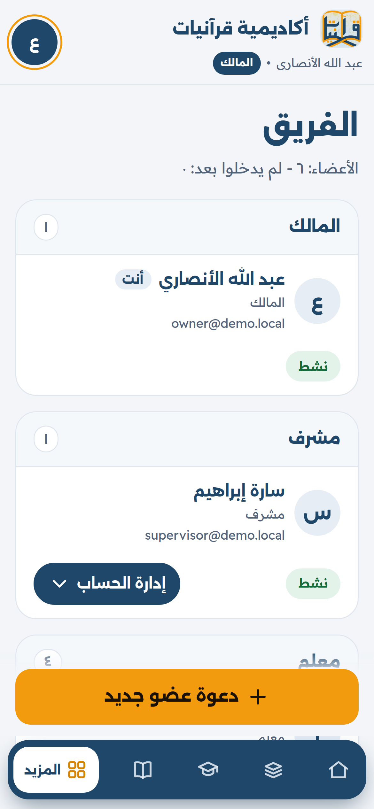</p>

**On a laptop**, the same app becomes a sidebar layout:

<p align="center">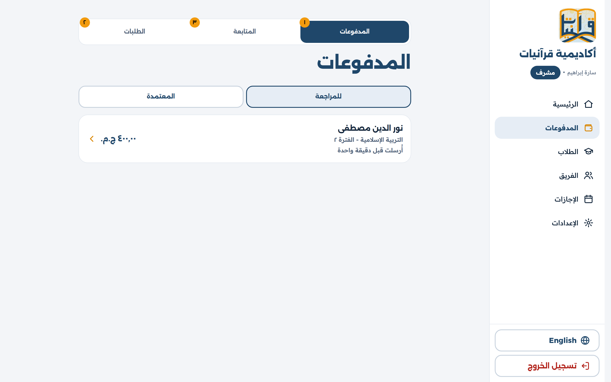</p>

## Engineering highlights

**A period engine that counts classes, not calendar days.**
A subscription period ends when its paid classes have been *delivered*, not on a date. Families
pay for a number of classes (say 12), not for a month. When the academy closes for Eid or a
holiday, those classes don't happen. With a calendar month, the family would lose them or staff
would have to fix each subscription by hand. Counting delivered classes means the period just
runs a little longer, and the family always gets every class they paid for. It also puts the due
date on one of the student's own class days. Sessions
are generated from each student's weekly pattern; absences, cancellations and academy closures
each affect the count differently. The delivered count is always derived from session rows,
never stored, so it can't drift. The engine projects each period's end date and works out when
a family is overdue. It is the riskiest part of the system, so it was built as its own slice
with its own test suite.

**Time zones done properly.**
Staff are in Egypt; families are in Egypt and the Gulf. Recurring slots are stored as local wall
time plus an IANA zone (Luxon), so classes stay at the right hour across DST changes and every
user sees times in their own zone. Days are numbered from Saturday everywhere, matching the
academy's week.

**Money stays with the role that owns it.**
Teachers enter data and propose a tier, but only the supervisor confirms the tier and price and
approves payments. Roles are enforced
server-side on every route, and every money-affecting change goes through one audit-log helper
that records only the changed fields and masks personal data.

**Database rules enforced in the database.**
Constraints and triggers back up the application logic. For example, a trigger rejects a pricing
tier that doesn't belong to the subscription's program. Request bodies and environment variables
are validated with zod, so the app refuses to boot with bad config instead of failing at 3am.

**Unattended jobs.**
A nightly job (scheduled from GitHub Actions) queues renewal notices and grace-period alerts,
flags teachers with unmarked classes, deletes old payment screenshots and expired logins, and
sends the day's Telegram notices. Each run is recorded. A second workflow backs up the database
to a separate storage bucket.

**Arabic-first, built for phones.**
RTL is the default layout, not a mirror added later; English (LTR) is fully supported. Every
role works mostly from a phone, so pages target a mid-range Android on Egyptian mobile data.
Uploaded screenshots are resized server-side with sharp before storage.

## Security

Security was part of each slice's definition of done, not a pass at the end. The app holds
children's names, parents' phone numbers and payment records, and most of its users are on
phones over shared mobile networks.

### Logins and sessions

- **Passwords hashed with argon2**, the current recommended algorithm.
- **Server-side sessions.** The cookie holds only a random id (`HttpOnly`, `SameSite=Lax`,
  `Secure` in production, and signed), and the database stores only its SHA-256 hash. A
  database leak alone can't be used to log in.
- **Session limits.** Everyone is signed out after 2 days without using the app. Owner and
  supervisor must log in again at least every 7 days, since they see payment data; teachers
  every 14 days.
- **Instant revocation.** Deactivating a user deletes their sessions, clears their cached roles
  and removes their Telegram access in one step. They're locked out on their next request.
- **Rate-limited login, backed by Redis.** At most 5 failed attempts per email and IP, and 20
  per IP, in 15 minutes. Only failures count, so a busy office isn't locked out.
- **No account enumeration.** A wrong email and a wrong password get the same answer, so an
  attacker can't use the login form to find out who works at the academy.
- **Invite-only accounts.** Teachers and supervisors can't sign up themselves. Invitation and
  password-reset links expire, and only their hash is stored.

### Why server-side sessions instead of JWT

The browser holds only a random session id, and the server looks it up on every request. I
chose this over JWT for three reasons:


The browser holds only a random session id in an `HttpOnly` cookie, and the server looks it up on
every request. I chose this over JWT for three reasons:

- **Instant revocation.** When a teacher leaves, the supervisor deactivates them and they're
  locked out on their next request. A JWT stays valid until it expires, unless you add a
  blocklist, which is a session table again.
- **Limits per role.** Owner and supervisor see payment data, so they must log in again
  sooner than teachers. That needs server-side state anyway.
- **One domain, one app.** The React app and the API share a domain, so a cookie just works.
  JWT's main advantage, stateless auth across many services, doesn't apply here, and the
  per-request lookup is cached in Redis.


### Permissions

- **Roles checked on the server on every route**, not only hidden in the UI.
- **Money decisions belong to the supervisor.** Teachers propose a tier; only the supervisor
  confirms it and approves payments; only the owner can reverse one.
- **Strict request validation with zod.** An unknown field is an error, not something quietly
  passed on. A teacher can't add `"price"` to a request by hand and have it saved.
- **Audit log** for every change that affects money or access, recording only the changed fields
  and writing personal data (names, phone numbers) as just "changed".
- **No double approvals.** Opening a payment holds it for one supervisor, and every edit sends
  back the version it was based on, so two people can't overwrite each other.

### Cross-site requests (CSRF)

Every request that changes data (`POST`, `PATCH`, `DELETE`) must come from the app's own address
(checked with the `Origin` header) and must be JSON. Another website can't make a logged-in
user's browser approve a payment.

### Injection

- **SQL injection.** All database access goes through Prisma, which sends values separately from
  the SQL text. The few hand-written queries (row locks, bulk inserts) use Prisma's tagged
  templates, which do the same. The app never builds SQL by joining strings, and never uses
  Prisma's `Unsafe` variants.
- **Cross-site scripting (XSS).** React escapes everything it renders, and the app never inserts
  raw HTML. Telegram messages are sent as HTML, so every value from the database (a child's
  name, say) is escaped first.
- **Command injection.** The server never runs shell commands, so user input can't end up in
  one. For example, image resizing uses the sharp library directly, not a command-line tool fed
  with the uploaded file's name.

### The parent upload link

Parents have no account, so the link itself is the credential, and it's treated like a password:

- **Long random token**, stored only as a hash. It expires and can be revoked.
- **It opens one thing:** the upload for one billing period. No names, history or other data.
- **Rate limited:** 5 uploads per link per hour, and 20 bad links per IP per hour, so links
  can't be guessed and a leaked link can't fill the storage.
- **Tokens never reach the logs.** Request logging replaces them with `[token]`.

### Uploaded files

Payment screenshots come from parents' phones through a public link, so every upload is treated
as possibly hostile. A file named `screenshot.jpg` could really be a script, or HTML with
JavaScript inside. If the server ran it, or a browser opened it as a web page while a supervisor
is logged in, the attacker's code would run with their access. So:

- **Size and count limits** (10 MB, one file) are enforced before the upload is read.
- **Type checked from the file's first bytes**, not its name or the browser's claim. Only real
  JPEG, PNG and WebP images get through.
- **Re-encoded with sharp** into a brand-new JPEG. Only the pixels survive: any hidden code is
  gone, along with EXIF metadata such as GPS location and phone model. The parent's original file
  is never stored.
- **Never executed.** Screenshots live in a private storage bucket, apart from the app's code,
  and nothing ever runs them.
- **Never served as-is.** Staff see only the clean copy, through the API, to signed-in users. It
  is sent as `image/jpeg` with `X-Content-Type-Options: nosniff`, so the browser treats it only
  as an image and never guesses it's a page. `no-store` keeps it out of caches.
- **Retention.** Old screenshots are deleted on a schedule, and files no payment points to are
  cleaned up.

### Configuration, secrets and infrastructure

- **Environment validated with zod at startup.** The app won't boot with a missing or weak
  secret.
- **Secrets only in environment variables**, never in the repository.
- **Machine-to-machine endpoints are authenticated.** The Telegram webhook and the nightly-job
  trigger each require a secret token, compared in constant time.
- **Telegram linking** uses a one-time code that expires in 15 minutes. Only admin accounts
  (owner, supervisor) can receive notices.
- **API responses are never cached** (`Cache-Control: no-store`). Every response holds
  personal or payment data, so no browser or proxy may keep a copy:
  - **Lost or shared phones.** Saved pages could still be shown after logout, for example by
    pressing Back.
  - **Stale money data.** A supervisor must never see a payment as pending after another one
    has approved it.
  - **Retention.** When an old payment screenshot is deleted, no copy should live on in a cache.

  The app is small, so the speed caching would add doesn't matter here. Only the app's built
  files (JavaScript, CSS, fonts) are cached, since their names change with every build.
- **Errors don't leak internals.** Clients get an error code and a request id; details stay in
  the server log.
- **Correct client IPs behind proxies.** Only Render's and Cloudflare's proxies are trusted, so
  rate limits apply to the real visitor and can't be dodged with a fake header.
- **Daily off-site database backups** to a separate bucket.

## Tech stack

| Layer | Choices |
| --- | --- |
| Frontend | React 19, Vite, React Router, CSS Modules, i18next (Arabic + English) |
| Backend | Node.js, Express 5, zod, Luxon, argon2, multer + sharp |
| Data | PostgreSQL 18 with Prisma 7, Redis (sessions cache, rate limits) |
| Storage | S3-compatible (Cloudflare R2) behind a swappable storage module |
| Integrations | Telegram Bot API (webhook in production, long polling in development) |
| Infrastructure | Docker, Render, Neon Postgres, GitHub Actions (nightly job + backups) |
| Testing | Node's built-in test runner against a real Postgres test database |

### Why Node's test runner and a real database

- **Node's built-in runner (`node --test`)** needs no extra framework: no Jest config and no
  plugins to keep up with Node versions. It has what this project needs: tests, setup hooks and
  assertions.
- **A real Postgres, not mocks.** Much of the logic lives in the database: constraints, triggers,
  row locks, and transactions that must commit or roll back together. A mocked database would
  pass tests that the real one fails. Running against Postgres also let me map the errors Prisma
  actually returns, not the ones in the documentation. Tests run one at a time on a separate test
  database, so they never touch development data.

### Why it runs on free hosting

The academy asked for this: for now, running the app costs them nothing. Free hosting is enough
because the app is for staff only. Parents and students never log in; parents only open a
one-page upload link. The free plans have limits, and the app is built around each one:

- **The app sleeps after 15 minutes without a visitor**, and the first visit after that waits
  about a minute. So nothing depends on a timer inside the app: GitHub Actions starts the
  nightly job, and that call wakes the app up.
- **Render's free Postgres is deleted after 30 days**, so the data lives on Neon instead.
- **Neon's free plan keeps only 6 hours of history**, so a nightly `pg_dump` goes to Cloudflare R2.
- **Render wipes the disk on every deploy**, so payment screenshots are stored in R2, not on disk.

The app runs at its Render address for now. A custom domain for the academy may come later.

## What's next

Planned, roughly in this order:

1. **Owner view.** One screen for the owner: revenue for the period, who is overdue, teacher
   load, and any notice type with nobody assigned.
2. **A custom domain** for the academy.
3. **Automatic WhatsApp messages to parents** through the WhatsApp Business API: renewal
   reminders and class reminders, sent by the app instead of copied by hand. Each message has a
   small cost, so it waits until the academy is ready to pay for it.
4. **Session reports.** The teacher records what was memorised in each class. Ayah ranges are
   stored, so progress can be shown later.
5. **Scheduling.** Teacher availability, makeup classes, and teacher-requested changes.
6. **Payroll** worked out from delivered classes. It's calculated by the app and paid by hand.
7. **Parent and student accounts.** Once the app faces families, parents get their own view and
   can message the teacher. Supervisors can read those messages and parents are told so.
   Students get no messaging.
8. **Card payments, Fawry and InstaPay** once the academy registers commercially. Until then,
   Vodafone Cash is the only method.
9. **The academy's own classroom** in place of the Zoom links classes use today.

## How it was built

I planned the product before coding: a PRD, API conventions, and a build plan split into nine
**vertical slices**. Each slice goes from database to screen and is useful on the day it ships:

0. Walking skeleton
1. Auth and roles
2. Programs, tiers, settings
3. Student intake
4. Period engine
5. Session marking
6. Payments
7. Nightly job
8. Telegram notices

Every slice had the same definition of done: migrations applied, every rule that decides money
or dates covered by tests, request bodies validated, deployed, and checked in both Arabic and
English.

## Project structure

```
client/          React SPA (pages, components, ar/en locales)
server/
  prisma/        Schema and migrations (with hand-written SQL constraints and triggers)
  src/routes/    API, one folder per resource
  src/lib/       Domain logic: period engine, payments, audit log, roles, Telegram
  src/jobs/      Nightly job: renewals, retention, unmarked classes
  scripts/       Admin CLIs (create owner, storage check, Telegram poller)
docs/            PRD, API conventions, build plan, one spec per slice, deploy guides
.github/         Nightly job and backup workflows
```

## Demo data

The screenshots come from a seed script in the private repository. It fills an empty database
with an invented academy by replaying seven weeks of activity through the app's own services, on
a simulated clock: classes marked every evening, payments uploaded and approved, a holiday
closure, an overdue family. So every screen shows data the real code produced.

---

<p align="center">
  Built by <a href="https://github.com/anas-refat-dev">Anas Refat</a> ·
  The source code is private. I'm happy to walk through it on request.
</p>
